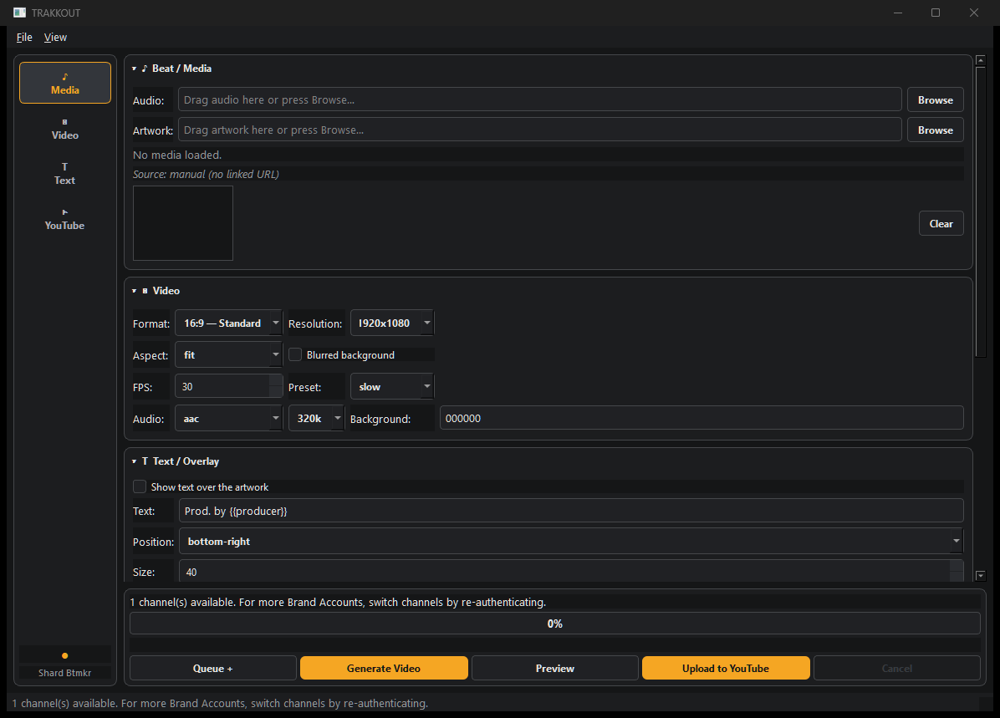

#  TRAKKOUT - Beat to YouTube Video Converter

> **Turn a beat and its artwork into a 1080p MP4 ready for YouTube** — audio + cover to video with FFmpeg, then upload to your own channel with title/description/tags templates and scheduled publishing.

**[Download for Windows](https://github.com/shardbeats/TRAKKOUT/releases/latest)** · **[All 6 tools](https://shardbeats.github.io/tools/)** · **[Free beat pack (WAV + stems)](https://shardbeats.github.io/landing/)**

<p align="center"></p>

Free and open source (MIT). No account on my side, no telemetry — the upload goes to **your** YouTube channel, authenticated with your own Google credentials.


<div align="center">
  
</div>

##  Description

**TRAKKOUT** is a modern, efficient desktop app for turning your music beats into full videos ready to publish on YouTube. It uses the official **YouTube Data API v3** and local **FFmpeg** to process your audio and artwork, generating an optimized MP4 video you can upload straight to your favorite channel.

###  Workflow

```
Beat/Audio + Artwork → FFmpeg → MP4 (1920x1080) → Select Channel → Upload to YouTube ✅
```

---

##  Main Features

| Feature | Description |
|---------------|-------------|
| 🎵 **Audio Processing** | Supports MP3, WAV, Opus and AAC at 192kbps/48kHz quality |
| 🖼️ **Smart Artwork** | Auto-fit to 1920x1080 (crop or letterbox) + optional blurred background |
| 📺 **YouTube Data API v3** | Secure OAuth authentication with automatic token refresh |
| ⏰ **Publish Scheduling** | Upload videos for future dates automatically (privacy: private by default) |
| 🎨 **Custom Templates** | `{{variable}}` syntax for dynamic title, description and tags |
| 📊 **Real-Time Progress** | GUI with progress bar that never freezes the main window |
| ⚡ **Safe Cancellation** | Correctly kills the child FFmpeg process on cancel |
| 💾 **SQLite History** | Stores every uploaded video for later reference |

---

##  System Requirements

### Recommended Minimum:
- **Operating System**: Windows 10/11 (64-bit)
- **Processor**: Intel Core i5 or equivalent
- **RAM**: 8 GB minimum, 16 GB recommended
- **Disk Space**: ~1 GB free (app + libraries ≈ 800 MB) + audio/artwork file size
- **Python**: 3.11+ (with `Add to PATH` enabled)
- **FFmpeg/FFprobe**: bundled inside the portable exe and the installer (from source: install locally or set it in **File > Settings**)

### Dependencies:
```bash
# Required Python packages (see requirements.txt)
PySide6>=6.6
requests>=2.31
google-auth>=2.23
google-auth-oauthlib>=1.1
google-api-python-client>=2.100
tzdata>=2024.1  # Windows only
```

---

##  Installation

### Quick start with `start.bat` (recommended)

1. Install Python 3.11+ from [python.org/downloads](https://www.python.org/downloads/)
   (check **"Add python.exe to PATH"**).
2. Install FFmpeg: `winget install Gyan.FFmpeg`
   (or set its path later in **File > Settings**).
3. Double-click **`start.bat`**: it creates the environment, installs
   dependencies and launches the app.
4. Continue below with the one-time Google setup (required for uploads).

### Set Up Google Cloud OAuth (required once, everyone)

1. Go to [console.cloud.google.com](https://console.cloud.google.com/) and create a project (e.g. `trakkout`)
2. **APIs & Services > Library**: find **YouTube Data API v3** → press **Enable**
3. **OAuth consent screen**:
   - User type: **External** → Create
   - App name: `TRAKKOUT`, support email: your address
   - Scopes: add `.../auth/youtube.upload` and `.../auth/youtube`
   - Test users: add your Google account (while in "Testing")
4. **Credentials > OAuth client ID**:
   - Application type: **Desktop app**, name: `TRAKKOUT Desktop`
   - **Download JSON** → save the file into `%APPDATA%\TRAKKOUT\`
     (any `client_secret*.json` name works, no need to rename)

### Enable YouTube Data API v3

Without it you will see the clear error: *"YouTube Data API v3 is not enabled…"*. Enable it in the Cloud Console and wait a few minutes.

### Manual setup (developers only)

If you prefer the terminal over `start.bat`:

```powershell
cd C:\path\to\trakkout
python -m venv venv
venv\Scripts\Activate.ps1
pip install -r requirements.txt
python -m app.main
```

---

##  Basic Usage

### Start the App:
Double-click `start.bat` (or `run.bat` if your `venv` is already set up).

### Usage Flow:

1. **Beat / Media**: Press **Browse** on *Audio* and *Artwork* to pick your local files (or drag & drop them in)
   ```
   audio: beat.mp3 + cover: cover.jpg ✅
   ```

2. **Fill In Metadata**: Complete the fields (Beat, Artist, Producer, Genre, BPM, Key, Purchase URL…)

3. **Use Templates** or write title/description/tags directly with `{{variable}}` syntax

4. **Select Channel**: Connect your Google account and pick the channel before uploading

5. **Generate Video**: Press **Generate Video** → review in **Preview** (title, description, length, resolution, channel, privacy)

6. **Upload to YouTube**: Confirm the dialog → resumable upload with progress, elapsed/remaining time and cancel

7. **Verify**: When done you will see **video ID + URL + channel** and a button to open it in the browser

---

##  Project Structure

```
trakkout/
├── app/
│   ├── main.py              # Main entry point
│   ├── models/
│   │   └── models.py        # Data models (BeatMetadata, etc.)
│   ├── services/
│   │   ├── video_generator.py    # FFmpeg video generation
│   │   ├── queue_manager.py      # Video processing queue
│   │   └── history_store.py      # SQLite history
│   ├── templates/
│   │   ├── engine.py             # {{variable}} template engine
│   │   ├── presets.py            # Template preset manager
│   │   ├── tags.py               # Tag parsing
│   │   └── compat.py             # Legacy {variable} API
│   ├── ui/
│   │   ├── main_window.py        # Main window shell (PySide6)
│   │   ├── mixins/               # MainWindow logic, split by domain
│   │   ├── workers.py            # Background threads for progress
│   │   ├── dialogs.py            # Settings / preview dialogs
│   │   ├── template_editor.py    # Template editor dialog
│   │   └── sections.py           # Sidebar + collapsible sections
│   ├── config/
│   │   └── settings.py           # App configuration
│   ├── ffmpeg/
│   │   └── ffmpeg_service.py     # FFmpeg service
│   ├── youtube/
│   │   ├── auth.py               # OAuth authentication
│   │   ├── errors.py             # API error handling
│   │   └── youtube_service.py    # YouTube Data API v3
│   ├── providers/
│   │   ├── base.py               # Abstract provider
│   │   └── local_provider.py     # Local file provider
│   ├── utils/
│   │   ├── files.py              # File utilities
│   │   ├── formatting.py         # Metadata formatting
│   │   ├── logging_setup.py      # Log configuration
│   │   ├── scheduling.py         # Publish scheduling
│   │   ├── validators.py         # Input validation
│   │   └── beat_names.py         # Title/BPM/key filename detection
│   ├── resources/                # Static resources (presets, etc.)
│   ├── logs/                     # Technical logs (app.log)
│   ├── client_secrets.json       # OAuth credentials (editable)
│   └── run.bat                   # Quick-launch script
```

---

##  Project Icon

The minimalist icon was created with **Pillow** with the following details:

- **Location**: `trakkout\trakkout.ico` (64x64 pixels, transparent PNG)
- **Design**: Red circle (YouTube style) + white diagonal line (play/music) + yellow circle (minimalist detail)
- **Colors**: Red (#FF0000), Yellow (#FFC107), White

---

##  Available Template Variables

| Variable | Source | Example |
|----------|--------|---------|
| `{{title}}` | Beat title field | `[FREE] {{title}}` |
| `{{artist}}` | Artist field | `Artist: {{artist}}` |
| `{{artist2}}` | Artist 2 field | `x {{artist2}}` |
| `{{producer}}` | Producer field | `Prod: {{producer}}` |
| `{{genre}}` | Genre field | `Genre: {{genre}}` |
| `{{bpm}}` | BPM field | `BPM: {{bpm}}` |
| `{{key}}` | Key field | `Key: {{key}}` |
| `{{purchase_url}}` | Purchase URL field | `📥 Purchase Link: {{purchase_url}}` |
| `{{tags}}` | Tags (comma-joined) | `Tags: {{tags}}` |
| `{{channel}}` | Selected YouTube channel | `Channel: {{channel}}` |
| `{{date}}` | Current date | `Date: {{date}}` |

**Bundled template example:**
```
Title: [FREE] {{title}}

Description:
FREE FOR NON PROFIT ONLY

📥 Purchase Link: {{purchase_url}}

🎚️ BPM: {{bpm}}
🎵 Key: {{key}}

👤 IG: @producer
```

---

## ⏰ Scheduled Publishing (Publish At)

In the *YouTube Metadata* section enable **"Publish later"**, pick date/time and timezone (e.g. `Europe/Madrid`). The app converts to UTC RFC 3339 and sends `status.publishAt` in `videos.insert`.

### YouTube API rules:
- ✅ The date must be in the **future**
- ✅ Privacy is forced to **private** when scheduling (the app does it automatically)
- ✅ The video shows as private/scheduled until the chosen date
- ✅ The queue shows the scheduled time per item and history marks it `Scheduled`

---

## 🐛 Common Troubleshooting

| Symptom | Likely Cause / Fix |
|---------|---------------------------|
| `FFmpeg not found` | Install FFmpeg (Installation, step 2) or set the path in **File > Settings** |
| `duration = 0` / corrupt file | Audio/image are damaged; try another file |
| OAuth won't open / cancelled | Check your `client_secret*.json` is in `%APPDATA%\TRAKKOUT\`; accept permissions in the browser |
| API not enabled | Enable YouTube Data API v3 in Cloud Console |
| `quotaExceeded` | Daily quota exhausted; wait or request more quota |
| Interrupted upload / offline | Retry; uploads resume in 8 MB chunks |
| Wrong channel | Re-authenticate picking the right Brand Account (Installation, step 3) |
| Out of space | Free disk space; the app estimates ~1.5 MB/s + 20 MB margin |
| `expired token` | The app refreshes automatically; if it fails, reconnect |

**Technical logs**: `logs/app.log` (tokens are redacted automatically)  
**SQLite history**: `%APPDATA%\TRAKKOUT\history.db` (History tab)  
**Settings**: `%APPDATA%\TRAKKOUT\settings.json` (no secrets)

---

## 📦 Contributing

To improve the project, you can:

1. **Open a Pull Request** with new features or fixes
2. **Report bugs** in the Issues tab (if GitHub is set up)
3. **Add template variables** using `TemplateEngine.register_variable(...)`

### ✅ Running the tests

```powershell
pip install -r requirements-dev.txt
python -m pytest tests -q
```

The suite covers pure logic (no GUI, network or FFmpeg needed): utils, models,
templates, settings, SQLite stores, YouTube error mapping and OAuth config validation.

---

## 📄 License

Copyright © 2026 - TRAKKOUT  
Distributed under the MIT license for personal and commercial use.

---

<div align="center">
  
</div>

**Made with ❤️ using Python + PySide6 + FFmpeg + YouTube Data API v3**

## TRAKK SUITE

Six free, offline tools for beatmakers. They are independent: install only what you need.

| Tool | What it does |
|---|---|
| [TRAKKSTUDIO](https://github.com/shardbeats/TRAKKSTUDIO) | Organize, convert and normalize in a single window |
| [TRAKKCONVERTER](https://github.com/shardbeats/TRAKKCONVERTER) | Sample libraries → WAV for the Roland SP-404MK2 |
| [TRAKKNORMALIZER](https://github.com/shardbeats/TRAKKNORMALIZER) | Per-clip peak normalization for sample packs |
| [TRAKKNAME](https://github.com/shardbeats/TRAKKNAME) | Beat title generator (EN/ES, 20 moods) |
| **TRAKKOUT** | Beat + artwork → 1080p MP4 for YouTube |
| [TRAKKLICENSE](https://github.com/shardbeats/TRAKKLICENSE) | Beat license contracts as PDF (EN/ES) |

- **Website:** https://shardbeats.github.io/tools/
- **Free beat pack (WAV + stems):** https://shardbeats.github.io/landing/
- **Sound kits:** https://www.beatstars.com/shardbeats/sound-kits

## FAQ

**Is it free?** Yes. MIT licensed, free for personal and commercial use. The only limit is Google's own YouTube API quota.

**Do I need a Google Cloud project?** Yes, once, for uploads. You create your own OAuth client and drop the JSON into `%APPDATA%\TRAKKOUT\`. The full walkthrough is under *Installation* above. If you only want the MP4 file and not the upload, skip it.

**Does it upload my files anywhere?** No. The video is rendered locally. Just one exception, and it is opt-in: pressing **Upload to YouTube** sends the video to the channel you authenticated.

**What does the video look like?** 1920x1080 MP4 from your audio plus cover artwork, auto-fitted with a crop or letterbox, with an optional blurred background.

**Can I schedule uploads?** Yes. "Publish later" sends `status.publishAt`; YouTube requires those videos to start as private.

**Can I template the metadata?** Yes, `{{title}}`, `{{bpm}}`, `{{key}}`, `{{purchase_url}}`, `{{tags}}` and more.
